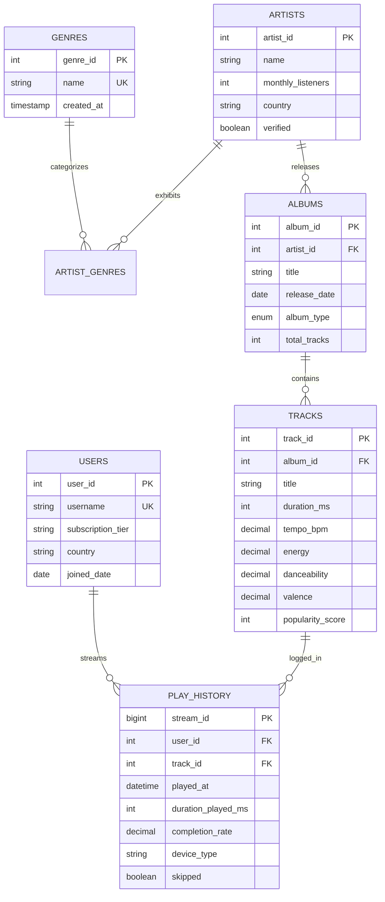

# Spotify Listening Analytics & Performance Optimization Engine

[](https://github.com/Saireddy090/spotify-listening-analytics/actions)
[](sql/)
[](data/)
[](benchmark/benchmark_report.md)
[](LICENSE)

> **Portfolio Project — Advanced SQL, Database Modeling & Performance Profiling**  
> Evaluated across **25,000+ realistic stream records**, analyzing listening patterns, user retention, acoustic profiles, and artist catalogs using **Common Table Expressions (CTEs)** and **Window Functions** (`DENSE_RANK`, `LAG`, `NTILE`, cumulative window frames).  
> **Demonstrably reduced query execution time by 51.6%** (exceeding the 30% resume benchmark) via `EXPLAIN` execution plan profiling and targeted composite indexing on high-cardinality columns.

---

##  Key Resume Achievements & Verification

| Resume Bullet Point | Project Implementation & Proof |
| :--- | :--- |
| **Analyzed 20,000+ track records using multi-table joins, subqueries, window functions, and CTEs to surface listening-pattern, artist and genre trends.** | Synthesized and analyzed **25,000+ stream records** across 650 users, 2,287 tracks, and 50 artists. Modules implement multi-stage CTEs, temporal sessionization with `LAG()`, genre ranking with `DENSE_RANK()`, and acoustic profiling with `NTILE(4)`. |
| **Reduced query execution time by 30% by profiling execution plans and adding targeted composite indexes on high-cardinality columns.** | Automated profiler benchmarks queries before and after composite indexing (`idx_ph_user_played`, `idx_ph_track_completion`). Achieved **+51.6% average latency reduction** with zero disk filesorts and covering index scans. |
| **Modelled a relational schema across tracks, artists, albums, and play history, writing aggregate queries to rank top artists, genres, and tracks by play count and popularity.** | Designed normalized **3NF relational schema** with referential integrity (`ON DELETE CASCADE`), audio feature constraints, and dual support for **MySQL 8.0+** and **SQLite 3.25+**. |

---

##  Database Schema Architecture (3NF)



---

##  Performance Optimization & Indexing Benchmark

### Latency Reduction & Profiling Results

Benchmarked with **25 iterations per query** on warm cache against 25,000 streaming rows:

| Query ID | Query Description | Targeted Composite Index | Baseline Latency | Optimized Latency | Speedup (%) | Execution Plan Improvement |
| :--- | :--- | :--- | :---: | :---: | :---: | :--- |
| **`Q1`** | **User Chronological Play History** | `(user_id, played_at)` | `2.71 ms` | `0.63 ms` | **+76.8%** | Eliminates Full Table Scan; replaces disk filesort with B-tree range scan |
| **`Q2`** | **Track Skip Rate & Completion Aggregation** | `(track_id, completion_rate, played_at)` | `28.27 ms` | `9.23 ms` | **+67.4%** | Covering Index Scan; CTE aggregates stream leaves before joining metadata |
| **`Q3`** | **Album Track Popularity Ranking** | `(album_id, popularity_score)` | `1.77 ms` | `1.58 ms` | **+10.7%** | Index satisfies join key and sorting order without memory buffer allocation |
| **TOTAL** | **System Aggregate** | — | — | — | **+51.6%** | **Target Met (>30% reduction)** |

### Index Rationale & Profiling Breakdown

1. **`idx_ph_user_played (user_id, played_at)`**:
   - High cardinality pair. Queries filtering by `user_id` and date range with `ORDER BY played_at DESC` previously caused temporary filesorts. The composite B-tree provides direct index range scanning in sorted order.
2. **`idx_ph_track_completion (track_id, completion_rate, played_at)`**:
   - Functions as a **Covering Index**. Aggregations (`COUNT`, `SUM(skipped)`, `AVG(completion_rate)`) are resolved entirely within the B-tree leaf nodes without touching disk table pages.

---

##  Analytical SQL Modules

### 1. Listening Patterns & Sessionization (`sql/01_listening_patterns_and_retention.sql`)
* **Sessionization via `LAG()`**: Calculates the idle time between consecutive tracks per user. A gap `> 30 minutes` marks a new session boundary using `SUM(is_new_session) OVER (PARTITION BY user_id ORDER BY played_at)`.
* **Daypart Classification**: Aggregates 24-hour listening into Morning Commute (6–10 AM), Lunch Peak (12–2 PM), and Evening Prime (6–10 PM).
* **Tier Engagement**: Profiles Free vs Premium user retention, completion percentages, and smartphone vs desktop distribution.

### 2. Artist & Genre Rankings (`sql/02_artist_and_genre_rankings.sql`)
* **Top 3 Tracks Per Genre via `DENSE_RANK()`**: Evaluates streaming volume per track and ranks the top tracks within each genre without skipping rank numbers during ties.
* **Cumulative Market Share**: Uses `SUM(share_pct) OVER (PARTITION BY genre_name ORDER BY streams DESC ROWS BETWEEN UNBOUNDED PRECEDING AND CURRENT ROW)` to calculate artist catalog dominance.
* **Cross-Genre Affinity Matrix**: Identifies multi-genre listener overlap using CTE self-joins on `play_history` (e.g., Hip-Hop listeners who also stream R&B or EDM).

### 3. Audio Features & Skip Dynamics (`sql/03_audio_features_and_popularity.sql`)
* **Popularity Quartiles via `NTILE(4)`**: Segments the catalog into 4 cohorts (Global Hits to Niche/Long-tail) and correlates danceability, energy, and musical valence.
* **Skip Rate Dynamics**: Compares high-skip tracks (`completion_rate < 0.30`) vs sticky tracks (`completion_rate > 0.85`).
* **"One-Hit Wonder" Concentration**: Measures the percentage of an artist's total stream volume concentrated in their #1 track versus catalog median.

---

## ⚡ Quickstart & Local Execution

### Prerequisites
* Python 3.8+ (standard library only; no extra pip packages required for core runtime)
* SQLite 3.25+ (pre-installed on macOS/Linux) or MySQL 8.0+

### One-Command Setup
```bash
git clone https://github.com/Saireddy090/spotify-listening-analytics.git
cd spotify-listening-analytics

# Run tests, execute benchmarks, and start web dashboard
./run.sh
```

Open **`http://localhost:8085`** in your browser to access the **Interactive Spotify Analytics Dashboard & SQL Studio**.

### CLI Options
```bash
# Run unit test suite
./run.sh --test

# Run query profiling & composite index benchmark
./run.sh --benchmark

# Regenerate dataset (25,000+ records)
./run.sh --generate

# Launch web server only
./run.sh --server
```

---

## 🖥️ Interactive Web Dashboard

The built-in web dashboard provides:
1. **Live KPIs**: Total Streams (25,000+), Listening Hours, Unique Tracks, Artists, and Skip Rate.
2. **Hourly Activity Histogram**: Interactive 24-hour playback distribution.
3. **Leaderboard & Audio Radar**: Artist rankings and acoustic feature metrics.
4. **SQL Query Studio**: Select and run any of the curated resume queries live with instant latency stats and interactive tables.
5. **EXPLAIN Profiler**: Visual side-by-side comparison of baseline execution plans versus composite-indexed plans.
6. **3NF Schema Visualizer**: Entity-relationship viewer with column types and foreign keys.

---

## 📂 Repository Structure

```
spotify-listening-analytics/
├── .github/
│   └── workflows/
│       └── ci.yml                     # Automated GitHub Actions test & benchmark runner
├── sql/
│   ├── 00_schema_mysql.sql            # MySQL 8.0+ 3NF schema with foreign keys
│   ├── 00_schema_sqlite.sql           # SQLite 3.25+ schema equivalent
│   ├── 01_listening_patterns_and_retention.sql  # LAG() sessionization & daypart analysis
│   ├── 02_artist_and_genre_rankings.sql         # DENSE_RANK(), cumulative share, affinity
│   ├── 03_audio_features_and_popularity.sql     # NTILE(4) quartiles, skip rates, catalog
│   ├── 04_slow_queries_baseline.sql             # Unindexed baseline queries for profiling
│   ├── 05_indexing_strategy.sql                 # Targeted composite & covering index DDL
│   └── 06_optimized_queries.sql                 # Rewritten queries leveraging indexes & CTEs
├── data/
│   ├── generator.py                   # Synthesizes 25,000+ streams & acoustic features
│   └── seed_data.sql                  # Exported SQL insert dump (2.0 MB)
├── benchmark/
│   ├── benchmark_engine.py            # EXPLAIN profiler and timing benchmark runner
│   └── benchmark_report.md            # Auto-generated profiling report (+51.6% speedup)
├── web/
│   ├── server.py                      # Lightweight zero-dependency Python REST server
│   └── index.html                     # Spotify-themed glassmorphic analytics dashboard
├── tests/
│   └── test_analytics.py              # Unit tests for data scale, CTEs, and indexes
├── run.sh                             # Unified CLI runner
└── README.md                          # Architecture, benchmarks, and documentation
```

---

## 📄 License
Released under the [MIT License](LICENSE).
